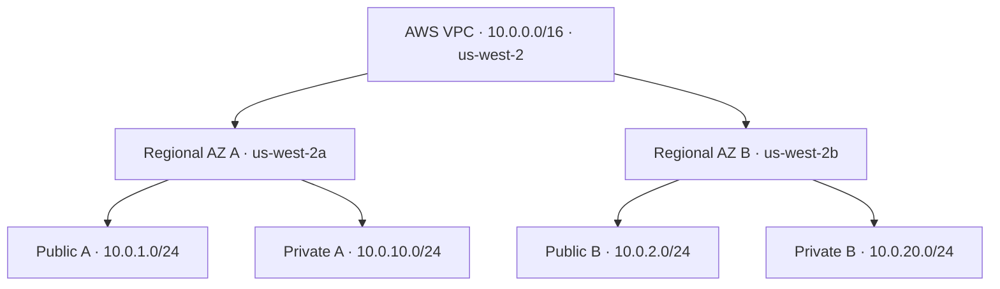

# Apex — AWS Cloud Infrastructure & Operations Engineering

**Terraform · AWS networking · Linux · CloudOps · troubleshooting · automation**  
**Independent engineering portfolio project — not a production customer environment**

> **Current milestone (2026-10-22):** A custom AWS VPC and four subnets were **applied** through Terraform. A real Local Zone placement error was diagnosed through AWS CLI and corrected with a reviewed Terraform replacement plan. **Post-fix CLI verification, a no-drift plan and the push of the deployed HCL are still outstanding.** Routing, compute, live application hosting and monitoring are not deployed.

## The engineering problem

A fictional small business runs a Linux web application with manual setup, limited operational visibility and uncertain recovery behavior. Apex explores how to build and operate a **repeatable, segmented, observable AWS application environment** using Infrastructure as Code instead of manual console configuration.

**The cloud infrastructure and its operations are the engineering deliverables.** The sample web application exists to exercise real networking, Linux administration, deployments, health checks and incident response.

## What is actually implemented?

| Capability | Observed or committed evidence | Status |
| --- | --- | --- |
| AWS networking | VPC `10.0.0.0/16`; four `/24` subnets provisioned using Terraform | **Applied; final post-remediation verification pending** |
| Terraform workflow | Authored HCL, `fmt`, `validate`, `plan`, `apply`; reviewed four forced subnet replacements | **Hands-on local work; code not yet pushed** |
| Troubleshooting | CLI revealed unintended LA Local Zones; data-source zone-type filter applied; 4 subnet replacements succeeded | **[INC-001 documented](docs/troubleshooting/INC-001-local-zone-subnet-placement.md)** |
| Python HTTP sample | Source with `/health` and offline unit tests | **Code committed; not deployed to AWS** |
| CI quality checks | Terraform format/validate, TFLint, Python tests, Gitleaks; advisory Checkov | **[Workflows](.github/workflows/)** (static checks, **no AWS deploy**) |
| Public routing, NAT, security groups | IGW, route tables, outbound access and rules | **Not deployed** |
| Linux / EC2 / IAM instance role / SSM | Private instance and controlled access | **Not deployed** |
| ALB / Auto Scaling / CloudWatch / containers | Application delivery and operations | **Not deployed** |

A successful Terraform apply proves resources were created; it does not by itself prove that all architecture or network-reachability requirements were met. See [project tracker](PROJECT_TRACKER.md) and [network verification checklist](docs/deployment/NETWORK_VERIFICATION.md).

## Network foundation: intended after subnet correction



**Important:** “public” and “private” here are intended tier names. **No custom IGW routes or route-table associations have been verified yet.** Regional subnet placements reflect the **approved Terraform replacement plan and successful apply**; the final read-only AWS inspection is still pending. See [architecture](architecture/README.md).

**Next system target:** internet-facing ALB in routed public subnets → Linux application on private EC2 instances managed with Systems Manager → monitoring, safe change workflows and realistic incident drills. [Target architecture and tradeoffs](architecture/README.md). Neither high availability nor production uptime is claimed.

## Real troubleshooting: INC-001

**Symptom:** Four subnets appeared in Los Angeles **Local Zones**, rather than the intended standard Oregon Availability Zones.

**Investigation:** Read-only `aws ec2 describe-subnets` exposed `us-west-2-lax-1a/b`; the available-zone data source did not filter `zone-type`.

**Fix:** Add `zone-type = availability-zone`, inspect a plan showing **4 adds and 4 destroys**, and apply the replacement. AWS did not need to replace the VPC.

**Status:** Terraform apply succeeded; post-remediation read-only inspection and no-drift verification are still required.

[Full incident report](docs/troubleshooting/INC-001-local-zone-subnet-placement.md) · [Issue #13](https://github.com/dbates91/apex-aws-infrastructure-modernization/issues/13)

## Find the code and evidence

| Resource | What it shows |
| --- | --- |
| [Terraform](terraform/README.md) | Environment/module design; **current local deployment HCL not yet pushed** |
| [Architecture](architecture/README.md) | Current CIDRs versus future target design |
| [Deployment verification](docs/deployment/NETWORK_VERIFICATION.md) | Repeatable AWS CLI and Terraform checks; clearly marked pending observations |
| [Troubleshooting](docs/troubleshooting/README.md) | Actual incident evidence and future controlled incident exercises |
| [Engineering case study](docs/portfolio/CASE_STUDY.md) | Problem, design, results and evidence limits |
| [Resume evidence](docs/portfolio/RESUME_EVIDENCE.md) | Interview-safe, current accomplishments and claims not yet earned |
| [Project tracker](PROJECT_TRACKER.md) | Implementation stage and outstanding acceptance gates |
| [CI workflows](.github/workflows/) | Offline/unit/static code checks; never applies AWS infrastructure |

## Run the local sample

```bash
python3 -m unittest discover -s tests -p 'test_*.py' -v
python3 application/server.py
# In another terminal:
curl -i http://127.0.0.1:8080/health
```

These are reproducible instructions, **not evidence the author personally executed every command**. The application is not deployed to AWS.

## Terraform sync and operational safety

The deployed Terraform configuration currently lives in the author's **local** `feature/apex-network-foundation` branch, in `terraform/environments/dev/`. GitHub `main` still contains a **provider-only root and an unattached draft networking module**. Do **not** apply the default-branch root or attach that draft module expecting it to adopt existing AWS resources. The local configuration and state must be reviewed, committed and synchronized first.

Use the correct AWS non-root identity and Region, review any planned deletes/replacements, and never commit Terraform state, credentials, private keys or unredacted command output. Remote state, IAM least privilege, cost measurement and automated deployment are later milestones, not achieved outcomes.

**Progress record:** [Phase 1 networking](https://github.com/dbates91/apex-aws-infrastructure-modernization/issues/2). The extensive [roadmap](PROJECT_ROADMAP.md) and [academy curriculum](docs/academy/) are supporting learning material, not evidence of completed infrastructure.
