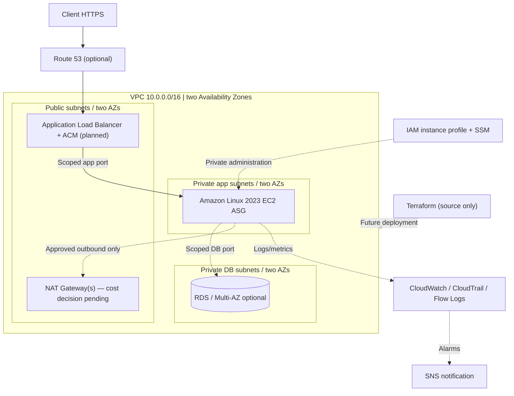

# Apex — AWS Infrastructure Modernization & Cost Optimization

**Status: implementation not deployed** · [CI: passing static checks](https://github.com/dbates91/apex-aws-infrastructure-modernization/actions/runs/38218409414) · **Six-week AWS Cloud Engineering Bootcamp** · **Target roles: AWS Cloud Support / Junior CloudOps / Cloud Engineer**

Apex is a **production-inspired, cost-conscious cloud modernization case study**: take a hypothetical manually managed Linux web service and design a secure, observable, reproducible AWS architecture. The business scenario is fictional; this is an independent portfolio project, not a deployed production service.

> **Truth in engineering:** No Apex cloud resources have been provisioned or benchmarked. The initial code is a local web-service sample and **unattached Terraform networking module**; all cloud deployment phases remain **Not Started** until independently verified.

## At a glance

| Capability | Engineering target | Verified state |
| --- | --- | --- |
| AWS networking | 10.0.0.0/16 VPC, public/app/DB subnets in two AZs, IGW, NAT/endpoints as justified | Planned; module source drafted, **not applied** |
| Compute / operations | Private Amazon Linux 2023 EC2, IAM instance profile, SSM and `systemd` | Not deployed |
| Availability | Public HTTPS ALB, private targets, ASG across AZs, controlled failure drills | Not deployed or tested |
| Application | Small Python HTTP app with `/health`, later hosted on Linux/Docker | Source included; cloud deployment pending |
| Infrastructure as code | Terraform modules, reviewed plans, protected state and drift analysis | Starter code only; no resources applied |
| Containers | Dockerfile, local image verification, later ECR and optional ECS/Fargate | Definition included; no build/deployment claimed |
| Security / audit | Scoped SG rules, least-privilege IAM, IMDSv2, encryption, CloudTrail / Flow Logs | Documentation and static checks; AWS controls not enabled |
| Observability / response | CloudWatch / SNS, runbooks, verified incident tickets | Planned |
| FinOps | Service estimates, resource tagging, teardown, before/after measurements | Planning templates; no actual AWS cost data |

## Architecture — proposed, not deployed



**Ingress:** HTTPS via the ALB; no broad internet SSH to private instances. **Administration:** SSM Agent + IAM and a verified outbound path (NAT or appropriate endpoints). **Data:** private and encrypted if implemented. A two-AZ design is an *objective*, not measured uptime. Read [network plan](architecture/networking-plan.md) and [architecture tradeoffs](architecture/README.md).

## Engineering workflow

1. **Learn** the AWS service, Linux concept, and tradeoffs.
2. **Build** the smallest approved lab, first using the console only when it teaches the underlying resource.
3. **Rebuild in Terraform** with a reviewed plan; do not accidentally manage the same resource in two places.
4. **Troubleshoot** controlled failures using metrics, logs, CLI and runbooks.
5. **Explain & repeat**, with sanitized command evidence, observed costs, teardown, and an interview-ready summary.

**Six-week plan:** [Weekly outcomes](BOOTCAMP_SIX_WEEK_PLAN.md) → [11-phase roadmap](PROJECT_ROADMAP.md) → [status and verification tracker](PROJECT_TRACKER.md). RDS Multi-AZ and ECS/Fargate are stretch goals, not prerequisites.

## Try the local application (no AWS account needed)

```bash
python3 -m unittest discover -s tests -p 'test_*.py' -v
python3 application/server.py
# In another terminal:
curl -i http://127.0.0.1:8080/health
```

The HTTP sample uses Python's standard library and synthetic responses. Commands above are *instructions*, not claimed test results. You may also run `docker build -f docker/Dockerfile -t apex-local .` **locally**; no image build has been verified on GitHub.

## Terraform (non-deploying root)

`terraform/environments/dev/` contains only provider configuration and an informational output; it references **no modules or resources**. `terraform/modules/networking/` contains *draft* VPC/subnet/route/SG source code, but it is deliberately not attached to the dev root. This prevents an accidental `terraform apply` from provisioning the planned VPC at this stage.

```bash
terraform fmt -check -recursive terraform
cd terraform/environments/dev
terraform init -backend=false -input=false
terraform validate
```

**Do not run `terraform apply` until Phase 0 account/budget approval and explicit implementation review.** Remote state is not configured; avoid committing secrets, .tfstate or plans. CI runs only local static checks, Terraform validation and secret scanning, with **no cloud deployment**.

## Security, cost, and operational proof

- [Security policy](SECURITY.md): least privilege, encryption, IMDSv2, reviewable changes and redaction.
- [Cost management](COST_MANAGEMENT.md): NAT, ALB, public IPv4, EC2/EBS, RDS, endpoints, logging, transfer and teardown; budgets alert but don't cap spend.
- [CI checks](.github/workflows/quality.yml): Python tests, Bash syntax, Terraform formatting/validation and security scanning; workflow execution status is visible in GitHub Actions, not asserted here.
- [Incident templates](docs/troubleshooting/README.md) and [runbooks](docs/runbooks/README.md): symptom → evidence → isolate → fix → validate → prevent.
- [Architecture decisions](docs/architecture-decisions/README.md): record meaningful choices, their alternatives and risks.
- [Portfolio case study](docs/portfolio/CASE_STUDY.md): recruiter-friendly evidence log, placeholders until confirmed.

## Repository navigation

| Directory | Contents |
| --- | --- |
| [architecture/](architecture/README.md) | Proposed topology, CIDRs, risk/tradeoffs, diagram source |
| [terraform/](terraform/README.md) | Environments, networking-module source, module contracts |
| [application/](application/README.md) and [tests/](tests/README.md) | Runnable local health-check application and tests |
| [docker/](docker/README.md) | Dockerfile and future ECR/ECS operations |
| [linux/](linux/README.md) | Amazon Linux 2023 operations labs |
| [scripts/](scripts/README.md) | Preflight/documentation checks and future CLI operations |
| [docs/](docs/README.md) | Runbooks, incident reports, deployment records, decisions and portfolio |
| [screenshots/](screenshots/README.md) | Redaction/evidence policy |

**Project maturity:** Foundation and source examples, not a deployed AWS solution. This repo intentionally makes planned vs verified work obvious to technical interviewers. Certifications are learning goals—not represented as earned.
