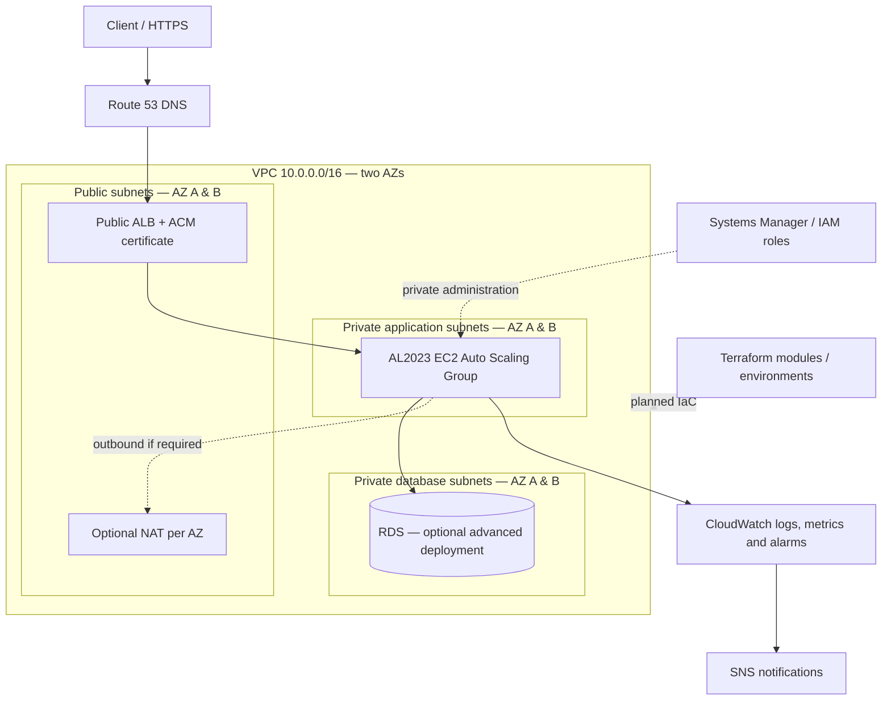

# Apex — AWS Infrastructure Modernization & Cost Optimization

> **Status: design and repository initialization. No Apex AWS infrastructure has been provisioned, deployed, validated, or benchmarked.** All AWS services, architectures, availability claims, and outcomes described below are **targets**, not completed work.

**Apex** is a production-inspired AWS Cloud Engineering portfolio project documenting the design, implementation, secure operation, troubleshooting, and cost optimization of a small Linux-based web application on AWS. It is an independent project and is **not** the existing `aws-three-tier-architecture-lab` repository.

**Career focus:** AWS Cloud Support Associate → Junior CloudOps Engineer → Cloud Engineer. Coursework alignment: AWS Solutions Architect – Associate (SAA-C03) preparation and future Terraform Associate study. Neither certification is represented as earned.

## Business problem

**Simulated business scenario:** A small application relies on manual infrastructure changes, has limited resilience, inconsistent operational visibility, and lacks repeatable deployment and spend controls. Apex proposes a phased AWS modernization with secure network boundaries, repeatable infrastructure definitions, incident response runbooks, and measurable operational evidence. This scenario does not describe an actual client or live production workload.

**Engineering outcomes to demonstrate when implemented:**
- Segregate a VPC across two Availability Zones and public, private application, and private database subnet tiers.
- Restrict Internet-facing access to the load balancer; manage private compute with AWS Systems Manager.
- Build an AL2023-hosted application with a health endpoint, then evaluate ALB and Auto Scaling.
- Encode resources using Terraform with reviewable plans, modular definitions, remote-state controls, and drift checks.
- Add observability, scripted automation, safe incident simulations, reproducible tests, and a documented teardown.
- Record real cost/availability findings only after verified tests.

## Target architecture — conceptual, not deployed

The diagram omits exact routes, endpoint placement, permissions, storage, and log destinations. These must be defined and verified when implemented; see [architecture](architecture/README.md).

## Planned stack

| Capability | Planned AWS services / tooling | Actual state |
| --- | --- | --- |
| Networking | VPC 10.0.0.0/16, two AZs, six subnets, IGW, route tables, NAT choice, VPC endpoints | Design only |
| Compute | EC2, Amazon Linux 2023, launch templates, ALB, Auto Scaling | Not deployed |
| Admin and security | IAM, instance profiles, Systems Manager, security groups, IMDSv2, EBS encryption | Not configured |
| Application / DNS | HTTP app, /health, Route 53, ACM, TLS | Not deployed |
| Database | RDS in private DB subnets; Multi-AZ optional | Not deployed |
| Infrastructure as Code | Terraform, providers, variables, outputs, modules, state controls | Non-deploying starter files only |
| Containers | Docker, Dockerfile, ECR, optional ECS/Fargate | Planned |
| Observability | CloudWatch, CloudTrail, VPC Flow Logs, SNS | Not configured |
| Automation | Bash, Python, AWS CLI; GitHub Actions later | Safe local starter checks / plans |

## Security design

Planned public ingress is HTTPS on the ALB (443); private application instance access is limited to the ALB security group; RDS access is limited to the application security group on its required port. There will be **no inbound SSH from 0.0.0.0/0**, no public IP addresses on private application or database instances, and no credentials stored in this repository. IAM instance roles will use least privilege and IMDSv2; at-rest encryption will be enabled for EBS and RDS. Private Systems Manager administration depends on SSM Agent, IAM, and either NAT connectivity or the correct interface VPC endpoints. Validate all assumptions rather than assuming Session Manager works by default.

For eventual AWS access, use MFA, short-lived credentials, and explicit permission boundaries. CloudTrail and VPC Flow Logs are planned audit sources, not claims of active data collection. [Security policy](SECURITY.md).

## High availability and cost tradeoffs

The intended HA demonstration places an internet-facing ALB and application targets across two AZs, with application health checks and recovery policies. A one-NAT-gateway lab variant may save money but creates an AZ-related outbound dependency; per-AZ NAT costs more. Database Multi-AZ and ECS/Fargate are advanced, optional expansions. Actual HA is **not claimed** until tested under failure conditions.

A personal AWS account can incur costs for NAT Gateways, public IPv4, ALB, EC2, EBS, RDS, CloudWatch, VPC interface endpoints, data transfer, Route 53, and logging. AWS Budgets alerts are **not spending caps**. Defer billable deployments pending cost approval, estimate and teardown planning. [Cost policy](COST_MANAGEMENT.md).

## Linux, application and containers

The Linux track covers Amazon Linux 2023, users and permissions, package management, `systemd`, logs, processes, service health, DNS, networking, and no-SSH private-instance troubleshooting. The application will expose `/health` for ALB checks and use synthetic data. Docker is initially local; versioned images and ECR come later, with optional ECS/Fargate after cost review.

## Terraform strategy

[terraform/](terraform/README.md) starts with an intentionally **non-provisioning** dev configuration: required provider, variables and outputs, **no AWS resources**. In Phase 4, introduce versioned, reusable modules; review `terraform fmt`, `validate`, and `plan` outputs; prohibit committing state and secrets; evaluate a protected, encrypted, versioned S3 backend with locking. Manual deployment in earlier phases is a learning exercise; Terraform later becomes the desired source of truth. **Do not run `terraform apply` at repository setup.**

## Monitoring, incident response and proof

Future CloudWatch metrics/logs/alarms, SNS notifications, scoped CloudTrail audit data, and Flow Logs will support incident drills. Example scenarios: incorrect routes, unhealthy ALB target, SSM connection failure, stopped web service, misconfigured security groups, and configuration drift. Every completed phase needs reproducible evidence, sanitized captures if appropriate, and a runbook—never invented metrics or screenshots.

## Six-week bootcamp sequence

| Week | Project phases | Focus |
| --- | --- | --- |
| 1 | 0–1 | Planning, budget audit, CIDR planning, networking |
| 2 | 2 | EC2, Linux admin, IAM instance profile, SSM |
| 3 | 3–4 | Web app, ALB, ASG, Terraform implementation |
| 4 | 5 | Docker, ECR, optional container service |
| 5 | 6–7 | Monitoring, auditing, Bash/Python automation |
| 6 | 8–10 | CloudOps incidents, recovery, optimization, documentation |

A six-week learning structure does not require deploying every expensive architecture variant. Advance only through verified acceptance criteria. [Full roadmap](PROJECT_ROADMAP.md) and [progress tracker](PROJECT_TRACKER.md).

## Repository navigation

| Path | Purpose |
| --- | --- |
| [architecture/](architecture/README.md) | Proposed subnet design, security boundaries and tradeoffs |
| [terraform/](terraform/README.md) | Non-provisioning IaC scaffold and future module strategy |
| [linux/](linux/README.md) | Administration and troubleshooting labs |
| [application/](application/README.md) | Future app contract and health checks |
| [docker/](docker/README.md) | Image lifecycle, ECR and optional ECS |
| [scripts/](scripts/README.md) | Local checks, future Bash/Python/AWS CLI tools |
| [docs/](docs/README.md) | Deployments, runbooks, incident records and architecture decisions |
| [screenshots/](screenshots/README.md) | Evidence-handling and redaction rules |
| [PROJECT_ROADMAP.md](PROJECT_ROADMAP.md) | Phase 0 through Phase 10 criteria |
| [PROJECT_TRACKER.md](PROJECT_TRACKER.md) | Phase status and links to proof |
| [COST_MANAGEMENT.md](COST_MANAGEMENT.md) | Cost guardrails and teardown |
| [LEARNING_OBJECTIVES.md](LEARNING_OBJECTIVES.md) | Learn → Build → Troubleshoot → Explain → Repeat |

## Current status

**Repository scaffold and documentation being initialized.** All implementation phases remain **Not Started** until directly verified. No AWS infrastructure provisioned; no AWS charges, screenshots, availability results, load tests, or certifications are claimed. The first actual engineering gate is Phase 0: account and cost audit, architecture design, and test-window approval.

