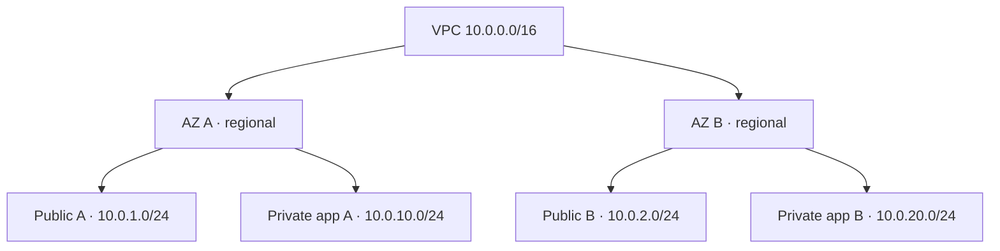

# Apex — AWS Architecture

**Scope:** Independent, production-inspired AWS engineering lab for a fictional Linux application. **Current build ≠ target architecture.**

## Current state — 2026-10-22

A Terraform-managed VPC (`10.0.0.0/16`) and four subnets have been applied in `us-west-2`. An initial mistake selected Los Angeles Local Zones; the corrected Terraform plan selected two **standard regional Availability Zones** and its `apply` completed successfully. **The post-remediation read-only AWS CLI check and no-drift plan are still outstanding.**

| Logical tier | AZ A target (`us-west-2a`) | AZ B target (`us-west-2b`) | Deployment evidence |
| --- | --- | --- | --- |
| Public (routing pending) | `10.0.1.0/24` | `10.0.2.0/24` | Subnets created and replaced; no public IGW routes verified |
| Private application (routing pending) | `10.0.10.0/24` | `10.0.20.0/24` | Subnets created and replaced; no outbound route or EC2 |
| Database (optional) | CIDR not allocated | CIDR not allocated | Not deployed |

**Terminology:** A subnet becomes public for IPv4 internet egress when its effective route table points to an attached internet gateway **and** the instance has appropriate public addressing/security configuration. The `public`/`private` resource names by themselves do not establish network reachability.

**No IGW, NAT, route-table configuration, ALB, EC2, RDS or monitoring capability is claimed as deployed.** The VPC also has AWS-created default networking objects, which do not constitute our intended tier routing. [Verification checklist](../docs/deployment/NETWORK_VERIFICATION.md) · [INC-001](../docs/troubleshooting/INC-001-local-zone-subnet-placement.md).

## Target architecture — not yet implemented

1. Client → public Application Load Balancer (HTTPS with a verified ACM certificate and optional Route 53 record).
2. ALB → private Linux EC2 application targets through narrowly scoped security-group rules.
3. Systems Manager manages instances with instance-role permissions and a **tested outbound path** via correctly routed NAT or appropriate VPC interface endpoints.
4. CloudWatch logs, alarms and operational runbooks provide observable failures and recovery checks.
5. Optional Auto Scaling and RDS private database tier are introduced only with a justified and testable architecture.

Two regional AZs offer a foundation for resilience, but **do not prove high availability** until a multi-AZ application is deployed and failures are tested.

## Key design decisions

- **IaC first:** Terraform is the source of intended infrastructure, AWS CLI is the independent inspection tool. Do not manually create the same resources and accidentally manage them twice.
- **Networking:** Public and private /24 CIDRs are deliberately spaced and non-overlapping. Local Zones are excluded from regional-AZ discovery using an explicit zone-type filter.
- **Security:** Future application instances will not require publicly exposed SSH; verify real SSM access before claiming this capability.
- **Outbound access:** One NAT versus NAT per AZ versus service-specific interface endpoints remains open. Compare operational dependencies and recurring costs before provisioning.
- **State:** Initial local Terraform state is not checked into Git; an eventual S3 remote backend requires a deliberate migration and protections.
- **Cost:** No actual cost savings, production traffic, uptime or incident SLA metrics have been measured.

See [network plan](networking-plan.md), [cost guidance](../COST_MANAGEMENT.md), [incident report](../docs/troubleshooting/INC-001-local-zone-subnet-placement.md) and [roadmap](../PROJECT_ROADMAP.md).
